<div align="center">


# Toadstone

**A toadstone was a gem people wore to detect poison. It never detected anything.**<br>
This one is named after that, on purpose.

[](LICENSE)
[](https://www.python.org/)
[](https://github.com/spcaeo/toadstone/actions/workflows/tests.yml)
[](#then-i-found-something-i-was-not-looking-for)
[](#quick-start)
[](https://spcaeo.github.io/toadstone/)

<table>
<tr>
<td width="50%" align="center">

### [▶&nbsp; Open the live demo](https://spcaeo.github.io/toadstone/)

**The real interface**, frozen over a real crawl.<br>
Click the tabs. Open a finding. No sign-up.

</td>
<td width="50%" align="center">

### [🎬&nbsp; Watch the tour](https://spcaeo.github.io/toadstone/watch.html)

**Two minutes.** Why it exists, what it found,<br>
and every view in the app.

</td>
</tr>
</table>

[Why this exists](#why-this-exists) ·
[Quick start](#quick-start) ·
[What it finds](#what-it-finds) ·
[Screenshots](#see-it) ·
[How it compares](#how-toadstone-compares) ·
[For agents](#for-agents-mcp-api-and-webhooks) ·
[Architecture](#architecture) ·
[Security](SECURITY.md) ·
[FAQ](#faq)

</div>

<picture>
  <source media="(prefers-color-scheme: dark)" srcset="assets/screens/hero-dark.png">
  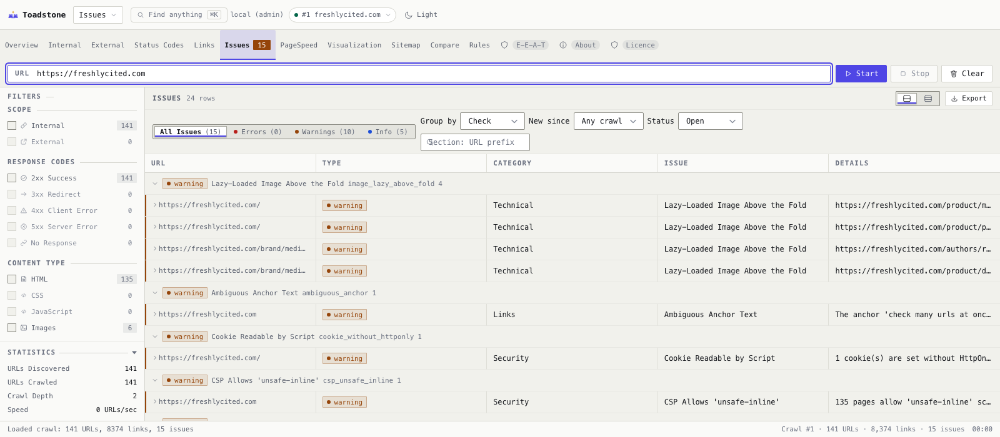
</picture>

<div align="center"><sub>A real crawl of <a href="https://freshlycited.com/">freshlycited.com</a>, a site we own and maintain: 141 URLs, 8,374 links, <b>zero errors</b> — and nine things worth fixing anyway, each with its machine-readable slug. <a href="#reproduce-the-screenshots">Reproduce it</a> against your own site, or against the broken fixture that ships in this repo.</sub></div>

---

## Why this exists

I run an SEO team of 22 people. Screaming Frog is licensed per machine.

That is not a complaint about the price — it is a good tool and worth its
licence. It is that the **shape** is wrong for how we work. We are in Ahrefs
every day. We need a full technical crawl maybe five or six times a month.
Paying a seat for every executive so each of them can run a crawl a handful of
times a month is paying for the wrong thing.

What I wanted was one instance I host myself, on my own Mac, that the whole
team can reach — and that **Claude Code can talk to directly over MCP**, so a
crawl comes back as a list of issues to fix rather than a CSV someone has to
open, read and turn into tickets.

Nothing available had that shape. So I forked an open-source crawler and
started building.

```bash
claude mcp add toadstone -- python -m src.mcp
```

That is the whole integration. Ten tools, read-only by default, **unmetered —
because they are your crawls, on your machine**. "Crawl freshlycited.com and
tell me what to fix" comes back as findings grouped by check, each with its
evidence and a one-line fix, ready to become tickets. No credits, no units, no
per-seat anything. [See the tools →](docs/mcp.md)

### Then I found something I was not looking for

Most SEO crawlers advertise how many checks they have. That number is almost
meaningless, and here is why.

I counted how many of the ones I had inherited had ever been *observed to fire*
on a real page. There were about 225. **Eighty-four of them had ever fired.**
The rest passed their unit tests and sat inert:

- eight AMP checks that could not fire on any site, because the markup they
  read was discarded before they ran;
- every PDF check, dead from the moment JavaScript rendering was switched on;
- a raw-versus-rendered comparison that had been comparing a document against
  itself;
- **a failed PageSpeed run that reported as a clean bill of performance** —
  the API returned a quota error, the integration swallowed it, and the report
  came back with no performance issues at all;
- three "checks" that were not checks, only sample data left in a test file.

None of that looked broken. Every report came back clean and confident, and
clean was the wrong answer.

So the project built a site that is wrong in as many ways as possible, crawls
it with the real crawler, and records which check slugs actually appear.

**The last sweep, run while this README was being written, fired 180 distinct
checks** across the fixture's six modes — 162 in the default run alone, on 77
crawled pages. Here is that sweep, in full:

```bash
python tools/coverage_sweep.py
```

```
--- default                 77 pages crawled, 162 checks fired
--- sitemap-limits-1         3 pages crawled,  76 checks fired   50,001 URLs, 51 children
--- sitemap-limits-2         3 pages crawled,  70 checks fired   a sitemap listing nothing
--- sitemap-limits-3         3 pages crawled,  75 checks fired   52MB of sitemap
--- silent-image            85 pages crawled, 166 checks fired   a handler that answers nothing
--- https                    4 pages crawled,  30 checks fired   the checks that need TLS

180 distinct checks fired across 6 mode(s)
```

Each mode needs a crawl of its own — a sitemap of 50,001 URLs cannot share a
run with one that works — and the sweep keeps a separate slug log per mode,
because the harness truncates its log at the start of every run. (Six runs
pointed at one file gives you the sixth mode's slugs and a confidently wrong
total. That mistake was made while writing this, and it reported 30.)

[`BUILD-LOG.md`](BUILD-LOG.md) carries the rest of the accounting day by day —
including the thirteen checks that rest on a stubbed transport with real
parsing either side, the one that rests on a model's verdict being supplied
rather than asked for, the two that cannot honestly be reached at all, and
every wrong turn taken on the way. It is written in the first person and it
does not flatter the work.

Those commands are the whole argument. Run them before you trust anything
above.

---

## What it is

A self-hosted SEO site crawler with a browser UI, an HTTP API, and an MCP
server so an AI agent can query crawls directly. It renders JavaScript, keeps
crawls so it can tell you what changed since the last one, and reports findings
with evidence a developer can act on without re-fetching the page.

It is a fork of [LibreCrawl](https://librecrawl.com) by Phiality, with roughly
a hundred commits of checks, integrations, API, agent support and UI work on
top. See [FORK.md](FORK.md) for exactly what the fork adds.

**No per-URL pricing, no seats, no cloud.** Point it at a site you have
permission to crawl and it runs on your machine.

### What a finding looks like

Every finding, wherever it surfaces — UI, API, export, MCP — carries the same
shape. This one is real, from the crawl in the screenshot above:

```json
{
  "id": "69230cd05f9f7ca9ec7a66ee0f91a85ccf9f0d90",
  "check": "links_to_broken_urls",
  "type": "error",
  "category": "Technical",
  "issue": "Page Links to Broken URLs",
  "url": "http://toadstone-demo.localtest.me:8977/",
  "details": "1 link(s) on this page are broken: http://toadstone-demo.localtest.me:8977/missing-entirely.png (404)",
  "evidence": {
    "found": "1 broken links",
    "related_urls": ["http://toadstone-demo.localtest.me:8977/missing-entirely.png"]
  },
  "how_to_fix": "Update or remove the link; a visitor following it hits an error.",
  "docs_url": "/checks#links_to_broken_urls",
  "status": "open",
  "first_seen_crawl": 2
}
```

Two things in there do more work than they look like they do:

- **`id` is `sha1(url + check + offending value)`.** The same defect keeps the
  same identity between crawls. A fixed issue never comes back as "new", an
  accepted one stays accepted, and `first_seen_crawl` tells you when it
  appeared. Most tools re-number their findings every run, which makes "what
  changed?" unanswerable.
- **`check` is a slug, never free text.** You can filter on it, alert on it,
  and diff on it. `docs_url` points at the generated reference page for it.

---

## Watch it work

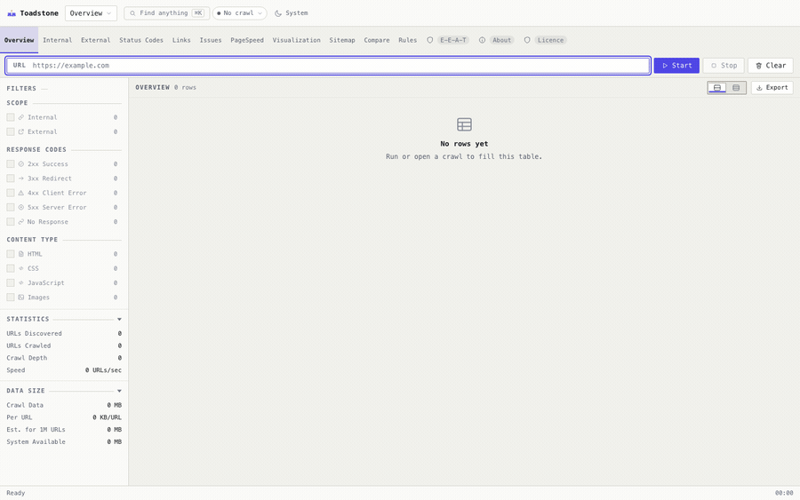

<div align="center"><sub>A real crawl of <a href="https://freshlycited.com/">freshlycited.com</a>, time-lapsed. Nothing staged: the URL is typed, the counters climb, and the findings at the end are the ones it actually found.</sub></div>

**[Open this crawl in the live demo →](https://spcaeo.github.io/toadstone/)** — the
real interface, not a report. Click anything; starting a new crawl is the one
thing it cannot do.
**It is the actual interface**, frozen over a real crawl — the same templates,
stylesheet and JavaScript, with every API response captured and replayed. Tabs
switch, filters filter, findings expand, the command palette opens. Starting a
new crawl is the one thing it cannot do. Built by `tools/build_demo_app.py`.

---

## What it finds

**222 checks**, 180 of them observed firing in the last sweep. Every one has a
slug, a severity, a category, an evidence block and a one-line fix. The running install generates its own
reference page at `/checks`, built from what it has actually reported rather
than from a hand-kept list that drifts.

| Area | What it looks at |
|---|---|
| **Technical** | Canonicals (relative, cross-domain, chained, pointing at a redirect or a noindex page), redirect chains and loops, noindex and nofollow, hreflang, headings, images, response times, page weight, mixed host and protocol links, tracking parameters on internal links |
| **Sitemaps** | robots.txt → index → children; URLs that 404, redirect, are noindex, canonicalise elsewhere or are blocked; crawled pages missing from the sitemap; `lastmod` missing, malformed, in the future or never bumped; the 50,000-URL and 50MB limits; duplicates across children; http/https and www drift |
| **Duplication** | Scored on the page body with header, nav, footer and sidebar stripped, by exact hash or 64-bit simhash, reporting **the shared passage** rather than a percentage. Pages that share a layout no longer read as duplicates because of their chrome, and URLs that canonicalise to each other never do |
| **Dates and freshness** | Missing, unparseable or timezone-less dates; JSON-LD, `article:modified_time`, HTTP `Last-Modified`, sitemap `lastmod` and the visible "Updated on…" disagreeing; stale pages; future dates; modified before published; **dates that are two reads of one clock rather than two events** |
| **Accessibility** | axe-core 4.10.2, around 200 rules, each becoming its own check with its own slug (`a11y_color-contrast`, `a11y_image-alt`, …) so you can filter and diff on them |
| **Rendered vs raw** | What the browser produced against what the server sent: content only JavaScript creates, links only JavaScript creates, text hidden after render, console errors, layout shift sources |
| **Security headers** | HSTS and its max-age, CSP, X-Frame-Options, X-Content-Type-Options, Referrer-Policy, Permissions-Policy, cookie flags, insecure form actions, active and passive mixed content |
| **Server logs** | Your own access log against the crawl: Googlebot user agents whose reverse DNS does not confirm, crawl budget spent on pages that only 404, pages nothing links to that are requested anyway, pages search engines have never requested, unreadable log lines |
| **Structured data** | JSON-LD parse errors, microdata and RDFa, FAQ markup, breadcrumbs, reviews |
| **AMP** | Thirteen checks, including the ones that only mean anything when you compare the AMP page with its canonical |
| **Content** | Thin content, spelling, grammar, punctuation, casing and style via LanguageTool, E-E-A-T signals, optional LLM analyst verdicts |
| **Performance** | PageSpeed Insights and Chrome UX Report field data: LCP, CLS, INP, FCP, TTI, Speed Index, performance score, desktop against mobile — **and an explicit finding when PageSpeed could not be reached**, because silence used to read as health |
| **CMS** | A read-only WordPress audit: the SEO plugin's own fields, placeholder values left in them, stray whitespace, expected author |
| **Between crawls** | Text removed since the last crawl, internal links lost, and a new / fixed / still-open report keyed on stable issue ids |

Full reference, slug by slug, with the ✅ against every one that has been
watched to fire: **[docs/checks.md](docs/checks.md)**. It is generated from the
running app's own catalogue by `tools/generate_checks_doc.py`, so it cannot
drift from the wording the code uses — and it lists the 59 that fired in the
harness but have no description yet, rather than quietly leaving them out.

---

## See it

Every screenshot below is the real app on a clean install, crawling a real
site — [freshlycited.com](https://freshlycited.com/), which we own, so the URLs
and the findings are genuine rather than staged. They are regenerated by a
script, and each one is checked for personal data before it is written.

### What is wrong

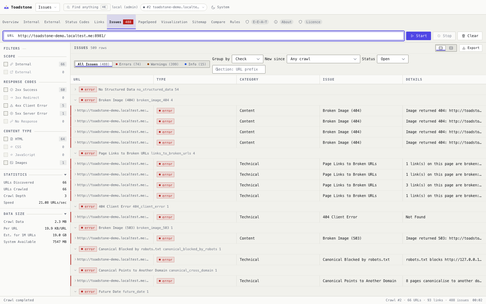

**Every check that fired, with its slug and how many pages it hit.** Collapse
the groups and the whole shape of a site's problems fits on one screen.

This one is the **bundled fixture** — the site in `tests/` built to be wrong in
as many ways as possible — because a healthy site makes a dull screenshot and
an honest one. 66 pages, 488 findings. The hero above is the same screen on a
real site that is in good shape; this is the same screen on one that is not.


**Grouped by check, because forty pages missing a canonical is one job, not
forty.** Filter by severity, response code, content type, section of the site,
or what is new since any previous crawl.

### What was found

<table>
<tr>
<td width="50%">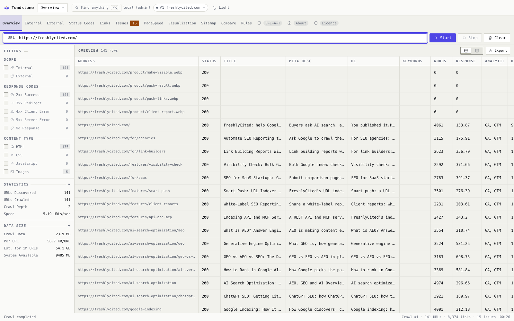</td>
<td width="50%">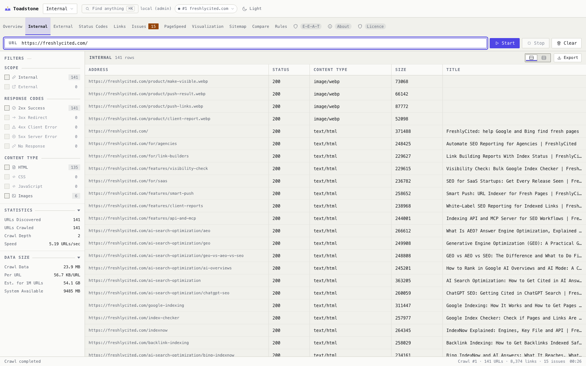</td>
</tr>
<tr>
<td><b>Overview</b> — every crawled URL with its SEO fields, sortable and exportable.</td>
<td><b>Internal</b> — the same for internal links, with status and depth.</td>
</tr>
<tr>
<td>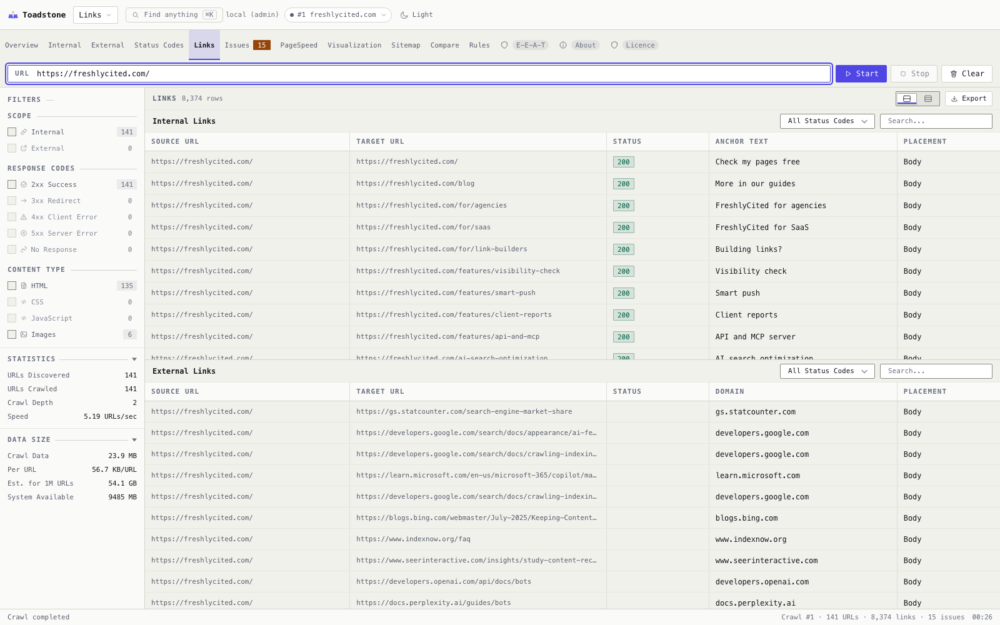</td>
<td>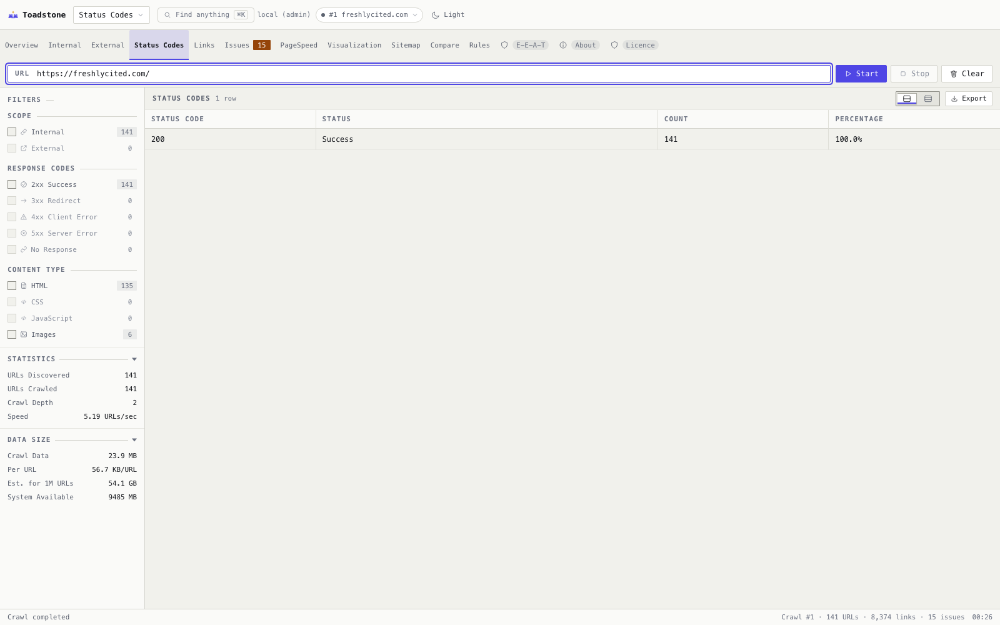</td>
</tr>
<tr>
<td><b>Links</b> — what points at a page and what it points at, with anchor text.</td>
<td><b>Status codes</b> — the whole response-code distribution, filterable.</td>
</tr>
</table>

### How it fits together

<table>
<tr>
<td width="50%">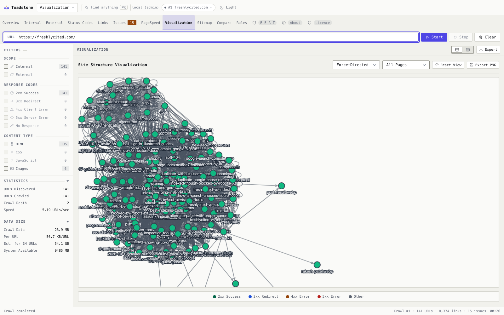</td>
<td width="50%">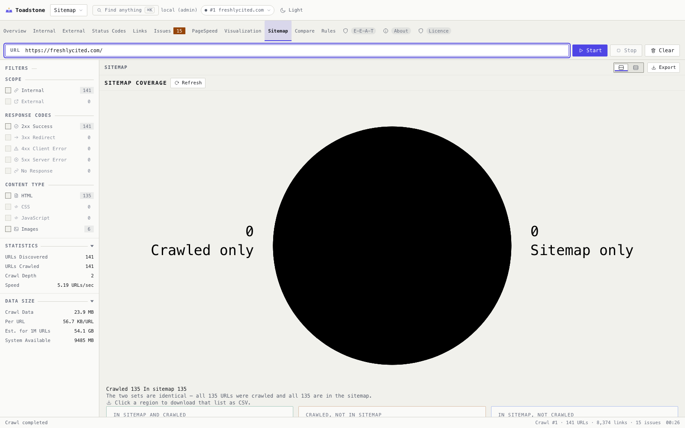</td>
</tr>
<tr>
<td><b>Structure</b> — click depth and clusters, drawn from the link graph.</td>
<td><b>Sitemaps</b> — discovery, parsing, and the coverage audit against the crawl.</td>
</tr>
<tr>
<td>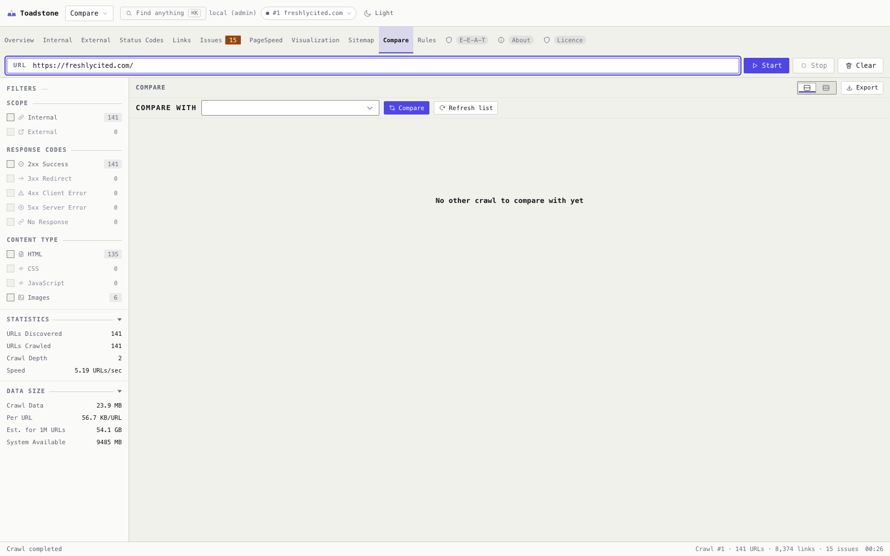</td>
<td>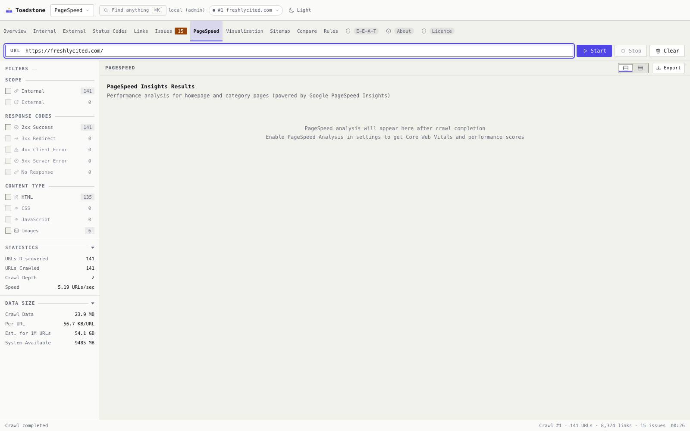</td>
</tr>
<tr>
<td><b>Compare</b> — new, fixed and still-open against any previous crawl.</td>
<td><b>PageSpeed</b> — lab and field data side by side.</td>
</tr>
</table>

### Getting around

<table>
<tr>
<td width="50%">
<picture>
  <source media="(prefers-color-scheme: dark)" srcset="assets/screens/mega-menu-dark.png">
  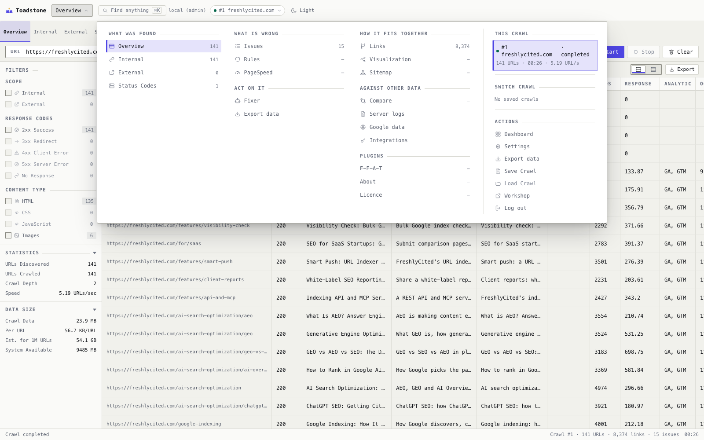
</picture>
</td>
<td width="50%">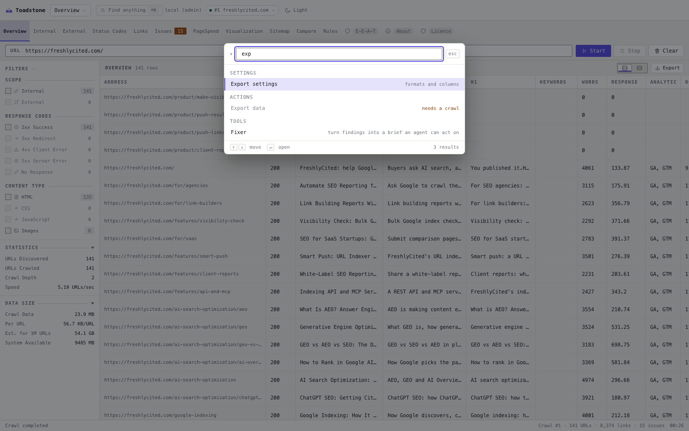</td>
</tr>
<tr>
<td><b>A menu grouped by job</b> — what was found, what is wrong, how it fits together, what to compare it against. Not by what shape the data happens to be in.</td>
<td><b>⌘K</b> — every view, setting and action, searchable. A command that cannot run right now says why instead of hiding.</td>
</tr>
<tr>
<td>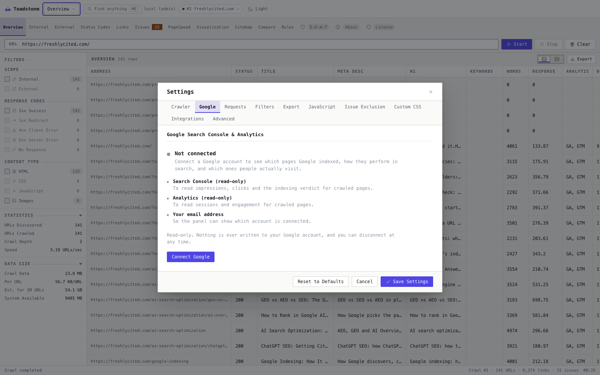</td>
<td>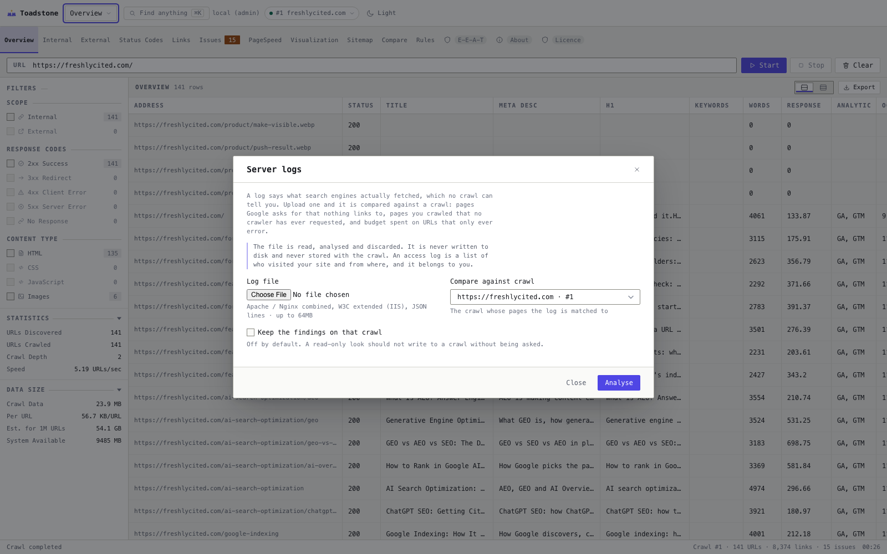</td>
</tr>
<tr>
<td><b>Connect Google</b> — one button, read-only, and the panel says what each scope is for before you grant it.</td>
<td><b>Server logs</b> — drop in an access log and it is read against the crawl.</td>
</tr>
</table>

### And one tab that is not about your site

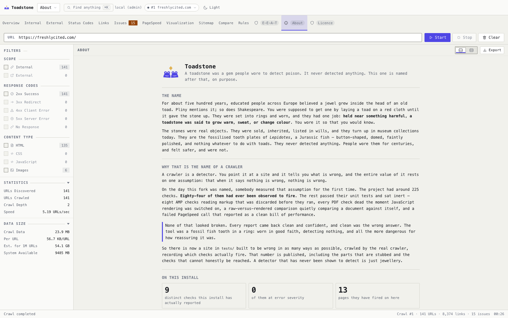

**About** sits at the end of the strip and tells the story — what a toadstone
was, why a crawler is named after a gem that detected nothing, and what the
audit found on the day this fork got its name. The last panel is live: it asks
*your* install how many distinct checks it has actually reported, so the claim
on screen is about your crawls rather than about somebody's marketing.

It is a plugin (`web/static/plugins/about.js`, ~180 lines) — the shortest
worked example of the plugin API, which is documented in
[docs/plugins.md](docs/plugins.md) if you want a tab of your own.

### And the licence, in plain words

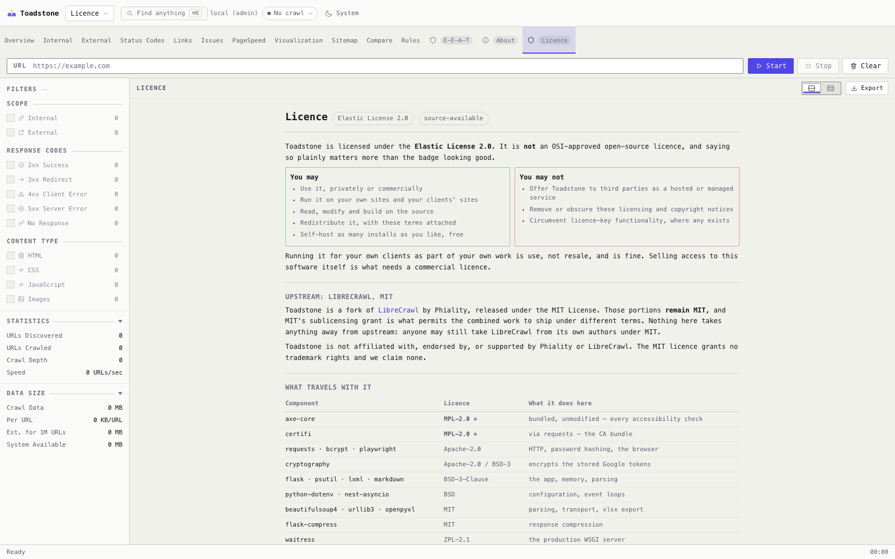

A source-available licence has terms people need to know *before* they build on
it, and "it's in `LICENSE` in the repo" is not where somebody running the app
will look. **Licence** sits next to About: what you may do, what you may not,
why the upstream MIT grant is what makes the relicence possible, and every
third-party licence that travels with the software — with the two copyleft ones
marked, because one of them surprised us.

### Dark mode, properly

<picture>
  <source media="(prefers-color-scheme: dark)" srcset="assets/screens/hero-light.png">
  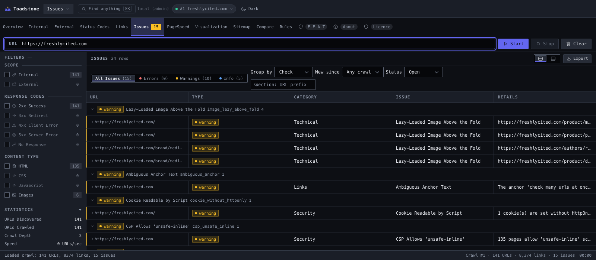
</picture>

<div align="center"><sub>Light, dark, or follow the system. This image flips with your GitHub theme — if you are reading in dark mode you are looking at the light one, and vice versa.</sub></div>

---

## Quick start

### Docker Compose (recommended)

```bash
git clone https://github.com/spcaeo/toadstone
cd toadstone
cp .env.example .env            # set SECRET_KEY, and a port if 5000 is taken
docker compose up -d
open http://localhost:5000
```

### Docker, without Compose

```bash
docker build -t toadstone .
docker run -d --name toadstone -p 5000:5000 \
  -v "$PWD/data:/app/data" \
  -e SECRET_KEY="$(python3 -c 'import secrets;print(secrets.token_hex(32))')" \
  -e LOCAL_MODE=true \
  --shm-size=2g toadstone
```

`--shm-size=2g` matters: Chromium crashes in a container with the default 64MB
of shared memory, and the crawl fails in ways that look like network problems.

### Python, no container

```bash
git clone https://github.com/spcaeo/toadstone
cd toadstone
pip install -r requirements.txt
playwright install chromium
python main.py --local --port 5057
```

> **On a Mac, pass `--port`.** macOS gives port 5000 to AirPlay Receiver, which
> answers every request with `403 AirTunes`. Everything looks like it started
> and nothing works. Either pass another port or turn off
> *System Settings → General → AirDrop & Handoff → AirPlay Receiver*.

### One command, no UI (for CI)

```bash
python main.py --crawl https://example.com --fail-on error --report issues.json
```

Exits non-zero when the crawl finds an open issue at that severity or worse, so
a pipeline can block a deploy on it.

### What you need

| | |
|---|---|
| **Python** | 3.11 or later (the Docker image is `python:3.11-slim`) |
| **Chromium** | installed by `playwright install chromium`; already in the image |
| **Memory** | ~1GB for a small crawl; a crawl stores page bodies, roughly 5–30KB per page |
| **A key, for some things** | Nothing is required. Google, PageSpeed, CrUX and the link-metrics vendors each add checks if you configure them, and say so plainly if you do not |

---

## Integrations

Every one of these is optional, off by default, and says when it could not run
rather than returning nothing and letting that read as health.

| Integration | What it adds | What it needs |
|---|---|---|
| **Google Search Console** | Impressions, clicks, CTR and position per crawled page; the indexing verdict from the URL Inspection API; a finding when Google picked a different canonical than the page declares | A Google account, connected with one button in Settings → Google. Read-only |
| **Google Analytics 4** | Sessions and engagement per page; pages with traffic the crawl never found; high-bounce pages | The same connection, same button |
| **PageSpeed Insights** | Lab Core Web Vitals for the homepage and two top-level pages, mobile and desktop | Nothing, but an API key avoids the shared anonymous quota |
| **Chrome UX Report** | Real-user field data for the origin and its pages | A free, read-only `GOOGLE_API_KEY` |
| **LanguageTool** | Spelling, grammar, punctuation, casing and style, as five separate checks | A LanguageTool endpoint; the public one is free and rate-limited, or run your own |
| **Moz / Majestic / Ahrefs** | Domain authority, spam score, external link counts, and pages with authority that nothing links to | A paid key from one of them. Without one, the checks report that the provider refused rather than reporting zero backlinks |
| **WordPress** | A read-only audit of the SEO plugin's own fields: over-long descriptions, placeholder values, stray whitespace, expected author | The REST API being reachable |
| **Your access log** | Bot spoofing by reverse DNS, crawl budget waste, pages never requested by search, requests for pages the crawl never found | An access log file. Nothing leaves the machine |
| **An LLM** | Analyst verdicts on page experience and E-E-A-T | A Claude CLI on the host. Off by default, because a crawler that silently spends money or sends a client's page text to a third party has broken someone's trust |

---

## For agents: MCP, API and webhooks

Toadstone was built to be read by software as well as people.

### MCP server

```jsonc
// Claude Code, Cursor, or any MCP client
{
  "mcpServers": {
    "toadstone": {
      "command": "python",
      "args": ["-m", "src.mcp", "--url", "http://localhost:5000"],
      "env": { "TOADSTONE_MCP_URL": "http://localhost:5000" }
    }
  }
}
```

It is **read-only by default**, restricted to hosts this install has already
crawled, and capped at 2,000 URLs per crawl — defaults chosen on the assumption
that nobody will ever re-read the config file they pasted it into. Writes need
an explicit opt-in. See [docs/mcp.md](docs/mcp.md).

### HTTP API

```bash
curl 'localhost:5000/api/crawls/133/issues?check=links_to_broken_urls&status=open'
curl 'localhost:5000/api/crawls/133/diff/132'           # new, fixed, still open
curl 'localhost:5000/api/checks'                        # the whole catalogue
curl -X POST 'localhost:5000/api/issues/<id>/accept' -d '{"reason":"by design"}'
```

Filters, formats (JSON, CSV, XLSX), crawl-to-crawl diffs, and issue acceptance
with a reason — an accepted issue stays accepted across crawls, because the id
is stable.

### Webhooks and scheduling

A crawl can POST its summary when it finishes, and the scheduler runs standing
crawls without anyone opening the UI.

---

## How Toadstone compares

Twenty-six tools, every cell traced to a page the vendor owns, all fetched
**2026-10-20**. **`nc` means not checked** — I could not confirm it from the
vendor's own material, so it is left blank rather than guessed. A gap is more
useful than a wrong tick, and corrections are welcome as a pull request.

**No prices in the capability tables, on purpose.** Published prices move,
third-party aggregators contradict each other and the vendors, and a README
full of 2026 figures is misinformation by 2027. Where a vendor publishes a
headline price on its own site it is noted in the pricing row; everything else
links out.

<sub>✓ documented · ◐ partial or conditional · ✗ the vendor's own material indicates absence · `nc` not confirmable</sub>

### Desktop and self-hosted crawlers

|  | **Toadstone** | [Screaming Frog](https://www.screamingfrog.co.uk/seo-spider/pricing/) | [Sitebulb](https://sitebulb.com/pricing/) | [Sitemoth](https://sitemoth.com/) | [Netpeak Spider](https://netpeaksoftware.com/spider) | [Visual SEO Studio](https://visual-seo.com/) | [Greenflare](https://github.com/beb7/gflare-tk) |
|---|---|---|---|---|---|---|---|
| Runs on | Docker / Python | Win · mac · Linux | Win · mac | Win · mac · Linux | Win · mac | Win · mac | Win · mac · Linux |
| Licence | **Elastic 2.0, source-available** | proprietary | proprietary | proprietary | proprietary | proprietary | **GPL-3.0** |
| Pricing model | self-hosted, free | annual licence, free ≤500 URLs | subscription, 14-day trial | free during beta, no account | subscription or one-off | annual per PC, free ≤500 URLs | free |
| Offline / air-gapped | ✓ | ◐ licence activation `nc` | ◐ | ✓ | ◐ | ◐ | ✓ |
| JavaScript rendering | ✓ Playwright | ✓ | ✓ | ✓ | ✓ | `nc` | ✗ |
| Crawl-to-crawl diffing | ✓ | ✓ | ✓ | ✓ | `nc` | ◐ store / load | ✗ |
| **Persistent per-finding id** | ✓ `sha1(url+check+value)` | `nc` | `nc` | `nc` | `nc` | `nc` | `nc` |
| Accessibility | ✓ axe-core | ✓ axe | ✓ axe-core, 98 hints | ✓ axe-core | ✗ | `nc` | ✗ |
| Server log analysis | ✓ built in | ◐ [separate product](https://www.screamingfrog.co.uk/log-file-analyser/pricing/) | ✗ | ✓ incl. fake-bot | ✗ | ✗ | ✗ |
| Search Console · GA4 | ✓ · ✓ | ✓ · ✓ | ✓ · ✓ | ✓ · ✓ | ✓ · ✓ | ◐ GSC only | ✗ |
| Spelling and grammar | ✓ LanguageTool | ✓ 25+ languages | ✗ | ✓ LanguageTool | ✗ | ✗ | ✗ |
| HTTP API | ✓ | ✗ CLI only | `nc` | ✗ CLI | ✗ | ✗ | ✗ |
| Webhooks | ✓ | `nc` | `nc` | ✗ | `nc` | ✗ | ✗ |
| Scheduling | ✓ | ✓ | ◐ Pro | ◐ via CLI | `nc` | `nc` | ✗ |
| MCP server | ✓ unmetered, your data | ✓ **29 tools, paid licence only** | ✓ read-only | ✓ 18 tools, can crawl | ✗ | ✗ | ✗ |
| Actively maintained | — | ✓ | ✓ | ◐ v0.1.12 beta | ✓ | ✓ | ✗ *no releases; site unpublished* |

### Cloud and enterprise platforms

|  | **Toadstone** | [Botify](https://www.botify.com/) | [Lumar](https://www.lumar.io/) | [Oncrawl](https://www.oncrawl.com/) | [JetOctopus](https://jetoctopus.com/pricing/) | [Conductor](https://www.conductor.com/platform/website-monitoring/) | [seoClarity](https://www.seoclarity.net/pricing/) |
|---|---|---|---|---|---|---|---|
| Where the crawl runs | your machine | vendor cloud | vendor cloud | vendor cloud | vendor cloud | vendor cloud | vendor cloud |
| Pricing model | self-hosted, free | quote only | quote only | quote only | published tiers | quote, usage-based | published from-price |
| Per-seat cost | none | `nc` | `nc` | `nc` | **none, unlimited seats** | `nc` | unlimited users |
| Server log analysis | ✓ | ✓ | ◐ via Logz.io / Splunk | ✓ no sampling | ✓ native, 40+ bots | ✗ | ✓ |
| **Continuous monitoring** | ✗ scheduled only | ◐ | ◐ | ◐ | ◐ | ✓ *its whole point* | `nc` |
| **CI/CD deploy gating** | ✗ | ◐ | ✓ **8 CI systems, blocks deploys** | `nc` | `nc` | `nc` | ◐ |
| Accessibility | ✓ axe-core | ✗ | ✓ WCAG 2.2, engine unnamed | ✗ | ✗ | ✗ | ✗ |
| HTTP API | ✓ | `nc` | ✓ REST + GraphQL | ✓ REST + OQL | ✓ | ◐ | ✓ |
| MCP server | ✓ | ✓ **+ agents that act** | `nc` | ✓ | ✓ can start crawls | ◐ AgentStack | ✓ |
| Scale it is built for | tens of thousands | millions | millions | millions | millions | millions | millions |
| Support you can phone | ✗ | ✓ | ✓ | ✓ | ✓ | ✓ | ✓ |

### The audit module inside an SEO suite

|  | **Toadstone** | [Ahrefs](https://ahrefs.com/pricing) | [Semrush](https://www.semrush.com/prices/) | [SE Ranking](https://seranking.com/subscription.html) | [Serpstat](https://serpstat.com/pay/) | [Sitechecker](https://sitechecker.pro/) | [Moz](https://moz.com/products/pro/pricing) |
|---|---|---|---|---|---|---|---|
| Where the crawl runs | your machine | vendor cloud | vendor cloud | vendor cloud | vendor cloud | vendor cloud | vendor cloud |
| Crawl budget | your disk | credits | pages per month | pages per project | pages per month | `nc` | `nc` |
| Per-seat cost | none | **+$40–80 per user** | from $45 / user | extra seats from ~$16 | tiered | `nc` | `nc` |
| JavaScript rendering | ✓ | ✓ | ◐ Enterprise add-on | ✓ opt-in | ◐ | `nc` | `nc` |
| Server log analysis | ✓ | ✗ | `nc` | ✗ | ✗ | ✗ | `nc` |
| Accessibility | ✓ | ✗ | ◐ Enterprise | ✗ | ✗ | ✗ | `nc` |
| **Backlink and keyword data** | ✗ *rents it, has none* | ✓ **best in class** | ✓ | ✓ | ✓ | ◐ | ✓ |
| Crawl-to-crawl diffing | ✓ | ✓ any two crawls | ◐ trend only | ✓ | ✗ | `nc` | `nc` |
| HTTP API | ✓ | ✓ | ✓ metered in units | ✓ | ✓ Team+ | ✓ | `nc` |
| MCP server | ✓ | ✓ | ✓ read-only | ◐ | ✗ | ◐ | `nc` |
| Rank tracking | ✗ | ✓ | ✓ | ✓ | ✓ | ✓ | ✓ |

> **Two rows deserve a caveat rather than a victory lap.** No vendor anywhere
> documents **persistent per-finding identity**, and **webhooks** are `nc`
> across all twenty-six. The honest claim is "no competitor documents
> equivalent behaviour" — not that they lack it. And `moz.com` could not be
> fetched from the environment this was compiled in, while every Bing Webmaster
> Tools help URL returned 404, so both are `nc` throughout and want a human
> with a browser.

### On check counts, including ours

Only Screaming Frog and Sitebulb back their number with a public library you
can count against — Sitebulb even enumerates its 98 accessibility hints.
Ahrefs' "170+", Semrush's "140+", SE Ranking's "115+" and Lumar's "250+/350+"
are marketing-defined with nothing public to count. JetOctopus, Oncrawl,
Botify, Conductor, seoClarity, Serpstat and Sitechecker publish no count at
all, so any claim that they have *fewer* checks than this would be
indefensible.

Counts are not a common unit either: 222 here and Sitebulb's "300+" do not
measure the same thing. **The unusual claim is not the count — it is the
coverage harness.** No vendor publishes anything comparable to "here is the
command, run it, watch which checks fire."

### An MCP server is no longer a differentiator

Ten of the twenty-six document one, Screaming Frog's being the deepest at 29
tools. What differs is what it may do and what it costs:

| | |
|---|---|
| **Toadstone** | Read your own crawls, unmetered, from your own install. Read-only by default, writes behind an explicit flag |
| **Screaming Frog** | The most capable — crawl control, bulk exports, URL inspection — but paid licence only, and its Node.js script-runner tools carry their own warning |
| **Sitemoth**, **JetOctopus** | Can start crawls, not only read them |
| **Sitebulb**, **Semrush** | Read-only |
| **Ahrefs**, **Semrush** | Metered: calls consume plan units |
| **Botify** | Goes furthest — agents that change the site, not only describe it |

---

**Trademarks.** Screaming Frog, Sitebulb, Sitemoth, Netpeak Spider, Visual SEO
Studio, Greenflare, SEO Macroscope, Botify, Lumar, Oncrawl, JetOctopus,
Conductor, seoClarity, Ryte, Ahrefs, Semrush, Moz, SE Ranking, Serpstat,
Sitechecker, Google, Search Console, Google Analytics, Chrome, Bing, axe, axe
DevTools, WAVE, Pa11y and LibreCrawl are trademarks or registered trademarks of
their respective owners. **Toadstone is not affiliated with, endorsed by,
sponsored by or supported by any of them.** Those names are used only to
identify the products being compared. The comparisons are drawn from each
vendor's own published documentation on the date stated, are offered as fair
comment, and may be out of date — a correction is a welcome pull request.

### The free baseline

**Google Search Console is not a crawler**, and that is the point. It tells you
what Google chose to crawl, on Google's schedule, capped at 1,000 example rows,
with validation that takes about two weeks. You cannot crawl a URL set of your
choosing, and **it can only ever see production, after the fact** — no staging,
no pre-release, no diff you control. Toadstone reads Search Console *and*
crawls; the interesting findings are where the two disagree.

Among paid tools the free tiers cluster hard at **500 URLs** — Screaming Frog,
Netpeak Spider, Visual SEO Studio and SiteAnalyzer all stop there. Sitemoth
(unlimited, free, no account) and the GPL projects are the only ones that do
not. Toadstone is in that company, not alone in it.

### The single-purpose tools

For log files alone, Screaming Frog's **Log File Analyser** is mature and
cheap, free up to 1,000 events. For accessibility alone, **axe DevTools**,
**WAVE** and **Pa11y** are better than any crawler's accessibility module,
this one included — Pa11y in particular does the CI half properly. Note that
Toadstone, Screaming Frog, Sitebulb and Sitemoth all wrap the *same* engine:
axe-core. Claiming accessibility as a differentiator against crawlers is fair;
claiming it against accessibility tools is not.

### Where others lead

- **Screaming Frog** — a decade of edge cases, the deepest MCP of anyone, spelling
  in 25+ languages, and unlimited URLs for one annual licence. Hard to beat on
  value, and its configuration depth is unmatched when a site is being strange.
- **Lumar** — stops regressions *shipping*: 8 CI systems and the ability to block
  a deploy that fails a health threshold. This finds things after they ship.
- **Conductor** — latency. Continuous monitoring, alerts the moment something
  changes, 60 months of page-level changelog. A scheduled crawl finds
  yesterday's regression.
- **Botify** — acts rather than reports: its agents and PageWorkers deploy the fix
  to the live site. The LLM analysts here score pages; they do not change them.
- **JetOctopus** — unlimited seats on every plan and millions of log lines ingested
  from a dozen CDN formats, at a price that needs no procurement process.
- **Oncrawl** — OQL across crawl, log and Search Console data, with exports into
  BI tools. A different product class from a crawler's filters.
- **Sitebulb** — explains *why* a finding matters better than anyone, with a public
  hint library that is a genuine teaching resource, and ticketing integrations.
- **Ahrefs and Semrush** — a backlink index and keyword data no self-hosted tool can
  reproduce. Toadstone has to rent that from Moz, Majestic or Ahrefs.
- **Sitemoth** — the uncomfortable one. Desktop, free today, 190 checks, axe-core,
  logs with fake-bot detection, LanguageTool, crawl comparison, and an MCP that
  can crawl. Whatever the case for Toadstone is, *"self-hosted with no per-URL
  pricing"* is not it against this.
- **All of them** — a company, a roadmap and support. This is a fork maintained by a
  small team, with no SLA and no phone number. The two dormant GPL crawlers in
  this survey are the honest illustration of how that can end.

### Who should use what

- **Crawl data must not leave your infrastructure** — NDAs, regulated sectors,
  staging sites that are not public → Toadstone.
- **You want an agent driving the crawler end to end, unmetered, over your own
  data** → Toadstone, or Sitemoth if a desktop app suits you better.
- **One or a few practitioners wanting the most capability per pound** →
  Screaming Frog, plus its Log File Analyser.
- **The deliverable is a prioritised report a client reads** → Sitebulb.
- **Millions of URLs, many seats, someone else running the pipeline** →
  JetOctopus, Oncrawl, Botify or seoClarity.
- **You need to know within minutes** → Conductor. **You need to block the
  deploy** → Lumar.
- **Site audit beside rank tracking, keywords and backlinks** → Ahrefs,
  Semrush or SE Ranking.
- **Accessibility is the actual job** → Pa11y in CI plus axe DevTools.
- **Toadstone is the wrong choice** if you need a backlink index, deploy-time
  gating, sub-minute alerting, a support contract, millions of URLs, or if
  nobody will operate Docker and a browser pool. And if the appeal was "free,
  self-hosted, lots of checks" — evaluate **Sitemoth** first. It is free today
  and covers much of the same ground.

---

## Architecture

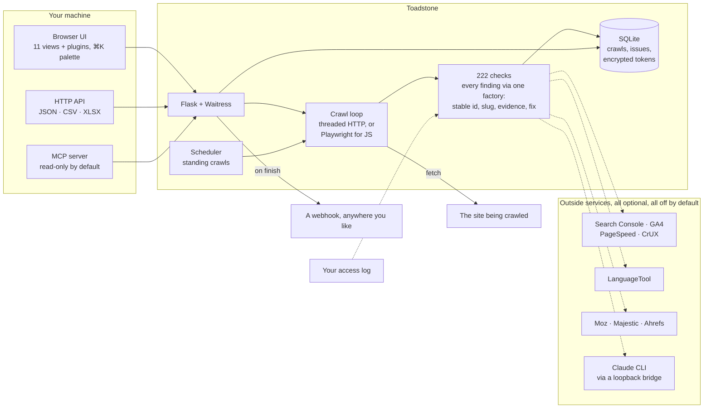

Three things in that diagram are worth saying out loud:

1. **Everything outside the box is optional and off by default.** A fresh
   install contacts nothing but the site you point it at.
2. **Every finding goes through one factory** (`src/utils/issue_factory.py`),
   which is why they all carry the same shape and a stable id. A check cannot
   invent its own format.
3. **The Claude bridge keeps the credential on the host.** The CLI ships as a
   native binary that will not run in a Linux container, so rather than bake a
   long-lived credential into the image, the container asks the host over a
   loopback-only bridge with a shared secret.

---

## Reproduce the screenshots

Every image in this README is generated, not curated:

```bash
python main.py --local --port 5058 &          # a clean install, empty data/
python tools/screenshots.py --app http://127.0.0.1:5058
```

With no `--site` it serves the **bundled fixture** — the deliberately broken
site in `tests/` — so anyone can reproduce the shape of these images without
having a site to point at. The published ones were taken with
`--site https://freshlycited.com/`, because a fixture on `127.0.0.1` looks like
a toy and ours is a real site we are allowed to show.

Either way it crawls through the UI exactly as a person would, captures every
view, and **refuses to write any screenshot whose page contains a banned
string** — which is not a theoretical guard. It caught six images carrying a
real connected Google account and other people's crawl history while this
README was being written, and nothing was written for those.

---

## Security and privacy

- **Nothing leaves your machine unless you configure it to.** No telemetry, no
  phone-home, no account.
- **Crawled page bodies are stored** so that crawl-to-crawl diffing works.
  Roughly 5–30KB per page; `Settings → Crawls to keep` bounds it.
- **Google tokens are Fernet-encrypted** under a key derived from `SECRET_KEY`,
  in their own table, and never written into the crawl config (which is
  snapshotted to the database and included in exports).
- **`--local` disables authentication entirely** and grants admin to everyone.
  Right on a laptop, wrong on anything reachable.
- **No third-party security audit has been performed.**

The full posture, including what has and has not been reviewed, is in
[SECURITY.md](SECURITY.md). Report vulnerabilities privately through
[a GitHub advisory](https://github.com/spcaeo/toadstone/security/advisories/new).

---

## FAQ

<details>
<summary><b>Is this open source?</b></summary>

No, and it is worth being precise about that. Toadstone is **source-available**
under the [Elastic License 2.0](LICENSE): you can read it, run it, modify it,
self-host it for yourself or your clients, and redistribute it. What you cannot
do is offer it to third parties as a hosted or managed service, or strip the
notices. ELv2 is not an OSI-approved open-source licence.

The portions inherited from LibreCrawl remain **MIT**, and nothing here changes
that — anyone can still take LibreCrawl from its own authors under MIT.
</details>

<details>
<summary><b>Why fork LibreCrawl instead of contributing upstream?</b></summary>

Much of what is here is upstreamable and some of it should be upstreamed. But
the fork started by auditing the existing checks and finding that most had never
been observed to fire, and the work that followed — a coverage harness, a stable
issue identity, an evidence block on every finding, an API and an MCP server —
changes enough of the shape of the thing that it would have been a very long
pull request with no reviewer. Upstream is credited in [NOTICE](NOTICE) and in
[FORK.md](FORK.md), and general crawler fixes should go there first.
</details>

<details>
<summary><b>How does it compare to Screaming Frog?</b></summary>

See [the comparison](#how-toadstone-compares). The short version: Screaming Frog
is mature, fast, extremely well understood, and better than this at most of
what both do. It also has the deepest MCP server of any vendor here — 29 tools,
including crawl control — so "an agent can drive it" is **not** a difference
between us, whatever you may read elsewhere.

What is different: the crawl and the data stay on your own machine, the
findings come out of an HTTP API rather than an export, nothing is metered, and
there is a published record of which checks have actually been watched to fire.
If you want a desktop app, a licence and support, buy Screaming Frog — it is
roughly £199 a year and worth it.
</details>

<details>
<summary><b>Will it crawl a large site?</b></summary>

The crawl is bounded by `max_urls` and by memory, and it stores page bodies, so
a million-URL crawl is not what this is for. It handles tens of thousands of
pages on ordinary hardware. The UI shows a live estimate of disk per URL and
what a million would cost, because that is a decision you should make before
starting rather than discover afterwards.
</details>

<details>
<summary><b>Does it respect robots.txt?</b></summary>

Yes, and it reports what robots.txt blocked rather than silently skipping it —
including sitemap URLs that are blocked and canonicals that point at a blocked
page. You can turn the obedience off for a site you own, which is a setting you
have to go and find.
</details>

<details>
<summary><b>What happens when an integration fails?</b></summary>

It says so, as a finding. This is the single most important design decision in
the project: a failed PageSpeed call used to produce no issues at all, which is
indistinguishable from a site with perfect Core Web Vitals. Every integration
now reports its own unavailability.
</details>

<details>
<summary><b>Can I use it commercially?</b></summary>

Yes — on your own sites, and on your clients' sites as part of your own work.
What ELv2 stops is offering Toadstone itself to third parties as a hosted or
managed service. If that is what you want to do,
[talk to us](https://www.labsmedia.com/contact/) about a commercial licence.
</details>

---

## Roadmap

Honest about what is not here yet.

| | |
|---|---|
| **Next** | A generated `docs/checks.md` that stays in step with the code · scheduled-crawl notifications beyond webhooks · a crawl-loop race recorded as open in [BUILD-LOG.md](BUILD-LOG.md) |
| **Known debt** | `web/static/js/app.js` is 4,548 lines and should be four files · three more files sit just over the project's own 1,000-line rule |
| **Wanted, not started** | Multi-site dashboards · a hosted demo · CSV import of a URL list to crawl · more CMS connectors than WordPress |
| **Deliberately not doing** | Rank tracking · keyword research · backlink *acquisition* · anything that writes to the site being crawled |

---

## Documentation

| | |
|---|---|
| **[docs/checks.md](docs/checks.md)** | Every check, by category, with its slug, severity and fix — and a ✅ against each one that has been watched to fire. Generated from the running app |
| **[docs/mcp.md](docs/mcp.md)** | The MCP server: every tool, the guardrails, config blocks for Claude Code and Cursor, and what it refuses to do |
| **[docs/google.md](docs/google.md)** | Connecting Search Console and Analytics: the five-minute OAuth client setup, the exact redirect URI, and what each scope is for |
| **[docs/agents.md](docs/agents.md)** | The optional LLM analyst layer, and the loopback bridge that keeps the credential on the host instead of in the image |
| **[docs/agent-handoff.md](docs/agent-handoff.md)** | Written for an AI agent rather than a person: how to drive a crawl end to end over the API and read the findings back |
| **[docs/plugins.md](docs/plugins.md)** | Writing a plugin: the register API, the lifecycle hooks, the data you get, and the two that ship — `about.js` is ~180 lines and is the example worth copying |
| **[docs/design/ui-redesign-2026-10.md](docs/design/ui-redesign-2026-10.md)** | The interface's design brief — tokens, density, the rail, and the reasoning behind each reference it borrows from. Historical: the work shipped, the brief is kept for the argument |
| **[docs/demo/video-script.md](docs/demo/video-script.md)** | The demo video, scene by scene, with the rule that no claim appears in it the repository cannot back |
| **[docs/demo/launch-post.md](docs/demo/launch-post.md)** | The launch narrative — long, short and one-line — plus the claims we deliberately do not make |
| **[docs/about-the-name.md](docs/about-the-name.md)** | Why a fake medieval gem is the right name for a crawler, and the audit that earned it |
| **[BUILD-LOG.md](BUILD-LOG.md)** | The day-by-day engineering record. 159 entries, first person, including every wrong turn. `tools/verify_build_log.py` fails CI if an entry ever goes missing from it |
| **[CHANGELOG.md](CHANGELOG.md)** | What changed and when, with the known problems listed rather than omitted |
| **[FORK.md](FORK.md)** | Exactly what this fork adds on top of LibreCrawl |
| **[SECURITY.md](SECURITY.md)** · **[CONTRIBUTING.md](CONTRIBUTING.md)** · **[CODE_OF_CONDUCT.md](CODE_OF_CONDUCT.md)** | How to report a vulnerability, how to get a change merged, and how to behave |

### Tools that ship with it

| | |
|---|---|
| `tools/coverage_sweep.py` | Runs every fixture mode and prints how many distinct checks fired. The number in the badge |
| `tools/screenshots.py` | Regenerates every image in this README, refusing to write one that shows personal data |
| `tools/build_demo_app.py` | Freezes the running app over a real crawl into a static site — the published live demo |
| `tools/generate_checks_doc.py` | Rebuilds `docs/checks.md` from the app's own catalogue |
| `tools/verify_google.py` | Makes real calls to Google and checks every field and enum against Google's published Discovery documents |
| `tools/verify_link_metrics.py` | Calls Moz, Majestic and Ahrefs and asserts each *refuses properly* without a key — because an integration that turns a refusal into `{}` reads downstream as "this page has no backlinks" |
| `tools/verify_build_log.py` | Fails if any entry the build log ever carried has gone missing |
| `tools/claude_bridge.py` | The host-side bridge for the optional agent layer |

---

## Built by LabsMedia

<a href="https://www.labsmedia.com/"></a>
<a href="https://www.spaceo.ca/"></a>

Toadstone is built and maintained by **[LabsMedia](https://www.labsmedia.com/)**,
the digital marketing division of
**[Space-O Technologies](https://www.spaceo.ca/)**, and led by
**Rakesh Patel**, founder of both.

We did not build this as a side project. We build links and run SEO for other
people's sites, which means we spend our days looking at crawl reports and
betting client money on whether they are true. The fork started because a report
came back clean on a site we already knew was broken — and the reason turned out
to be that most of the crawler's checks had never once been observed to fire.
Everything in this repository follows from refusing to accept that again.

If you want that same scrutiny applied to your site, or links that are
relevant, real and live rather than counted:

| | |
|---|---|
| **AI link building** | [labsmedia.com](https://www.labsmedia.com/) — Scout finds the sites, negotiates the price, and verifies the backlink is live on the page before anyone is invoiced |
| **Guest posts and link insertions** | [labsmedia.com/services](https://www.labsmedia.com/) |
| **Software and platform work** | [spaceo.ca](https://www.spaceo.ca/) |
| **Talk to a human** | [labsmedia.com/contact](https://www.labsmedia.com/contact/) |

We also build **[Skald](https://github.com/spcaeo/skald)** — self-hosted web
analytics read from your server's own access log, which sees the AI assistants
and crawlers that JavaScript analytics cannot. Toadstone tells you what is wrong
with a site; Skald tells you who actually came to it.

---

## Credits

**[LibreCrawl](https://librecrawl.com) by Phiality**, released under the MIT
License, is the crawler this is built on. The MIT grant is also what makes it
legal to distribute this work under different terms, and it would be poor
manners not to say so clearly: a solo developer's work is the reason this
project exists at all. Upstream is untouched beneath this fork, and its updates
still merge.

**[axe-core](https://github.com/dequelabs/axe-core) by Deque Systems** (MPL-2.0),
bundled unmodified, is every accessibility check here.

**Toadstone is not affiliated with, endorsed by, or supported by Phiality or
LibreCrawl.** The MIT licence grants no trademark rights and we claim none. If
something here is broken, it is ours, and the issue tracker is
[here](https://github.com/spcaeo/toadstone/issues) — not theirs.

Every other dependency, with its licence, is listed in [NOTICE](NOTICE).

---

## Contributing

One rule above all the others: **a check is not finished until it has been seen
firing in a real crawl.** [CONTRIBUTING.md](CONTRIBUTING.md) explains what that
means in practice, along with how to run the suites (34 of them, no framework,
plain scripts) and what a pull request needs to show.

Found a check reporting something that is not true? That is the most valuable
issue this project can receive — there is
[a template for it](.github/ISSUE_TEMPLATE/false_positive.yml).

---

## Licence

[Elastic License 2.0](LICENSE) — source-available, not OSI open source.
Self-host it, modify it, use it on your own and your clients' sites. You may not
offer it to others as a hosted or managed service without a commercial licence.
Portions inherited from LibreCrawl remain MIT.

Copyright 2026 Space-O Technologies. Author: Rakesh Patel.

<div align="center"><sub>A toadstone was a gem people believed grew in a toad's head, worn to detect poison. They were real objects, they were fossilised fish teeth, and they never detected anything. People wore them for centuries, felt safer, and were not. <a href="docs/about-the-name.md">That is why the name is on this tool.</a></sub></div>
